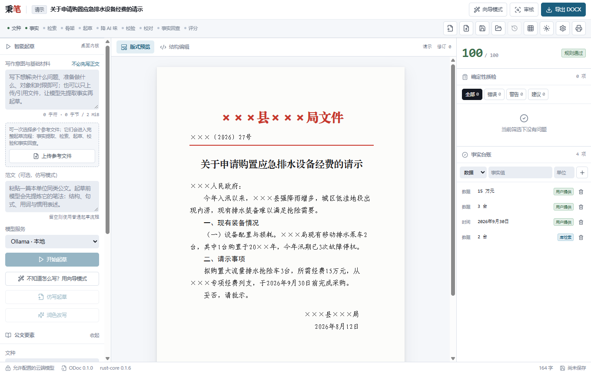

# 秉笔 · my-bingbi

秉笔为中文公文写作者提供桌面工作台，将参考材料、可选知识库和模型连接到起草、审核及 DOCX/PDF 排版流程。

[](https://github.com/hellomrli/my-bingbi/actions/workflows/ci.yml)
[](LICENSE)

## 安装并起草第一份文档

从 [Releases](https://github.com/hellomrli/my-bingbi/releases) 下载 Windows x64 安装器或 Linux amd64 `.deb` / AppImage。Debian/Ubuntu 在下载目录安装：

```bash
sudo apt install ./my-bingbi_*_amd64.deb
```

1. 打开秉笔，在首次引导或设置中配置模型服务；可用自己的云端服务或本地 Ollama。
2. 在写作台写明任务、对象、已知事实和时限，按需上传参考材料。
3. 点击“开始写作”，生成后检查正文、事实台账和质检结果。
4. 修正未核实的数字、日期和文号，再导出 DOCX、PDF 或打印。

知识库可选，没有 Obsidian 也可以起草。云端模型会接收本次提交的材料和引用片段；需本地处理时选择本地模型并核对设置。



## 写作和审核能力

- 起草、仿写、语义审核及单段改写，支持预览后应用和版本恢复。
- 结构化事实台账及规则质检；检测到的错误可阻断导出，仍需要人工复核。
- GB/T 9704-2012 的版面与格式规则，支持机关 Word 模板和内置 Typst PDF 导出。
- 本地 Markdown Vault、FNS 或 MCP 知识库接入，以及可启用或停用的声明式知识包。
- 按流水线阶段选择模型服务，记录 token 消耗，提供可选 Cline Pass 面板。
- 本机 SQLite 保存文档，凭据使用系统 Keyring，安装包更新使用签名验证。

排版规则和事实回查是辅助检查，不能保证所有文字、依据或法规要求已自动核实。字体、模板和最终页数需检查导出结果。

## 查阅使用和开发文档

- [文档入口](docs/index.md)
- [写作、改写与模板](docs/writing.md)
- [模型服务与 Cline Pass](docs/models.md)
- [建立和连接知识库](docs/knowledge-base.md)
- [质检、事实回查和导出](docs/exporting.md)
- [排错与在线更新](docs/maintenance.md)
- [本地开发](docs/development.md) · [架构](docs/architecture.md)

## 反馈、来源与许可证

问题请提交 [Issue](https://github.com/hellomrli/my-bingbi/issues)，提供版本、系统和脱敏诊断。贡献方式见 [CONTRIBUTING.md](CONTRIBUTING.md)，漏洞报告见 [SECURITY.md](SECURITY.md)。

采用 [MIT License](LICENSE)。公文知识包的上游来源、授权和方法转换记录见 [来源说明](docs/attribution.md)，各包保留自己的第三方声明。
