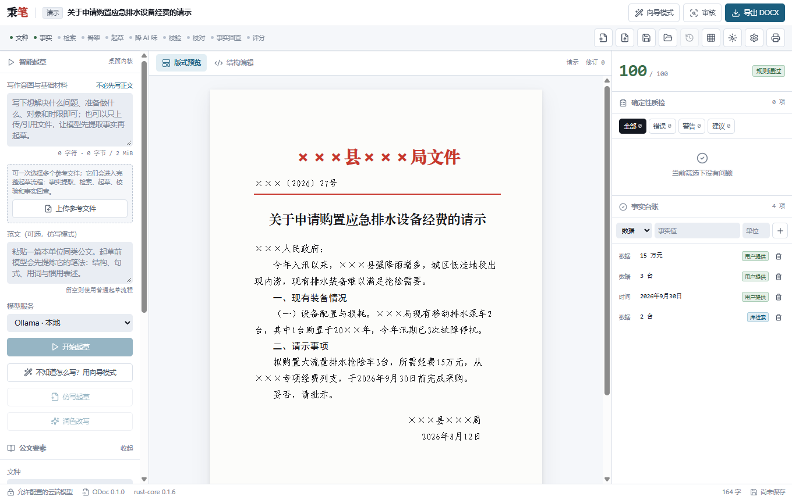
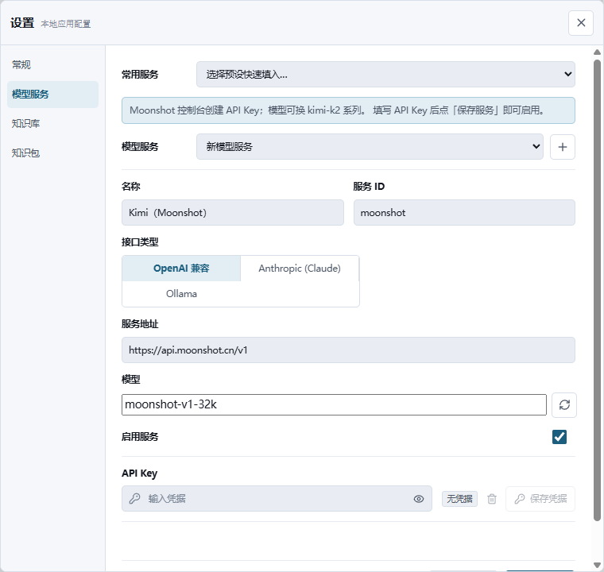
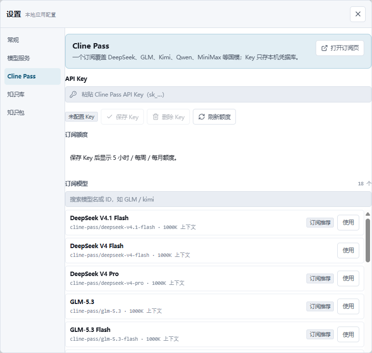
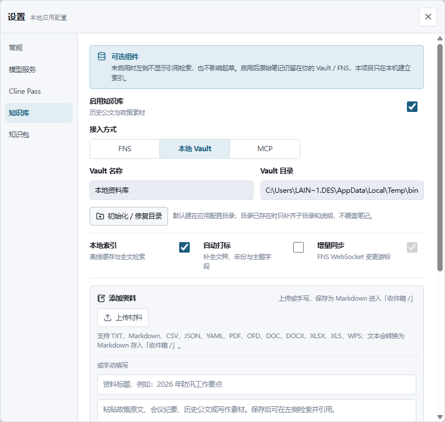
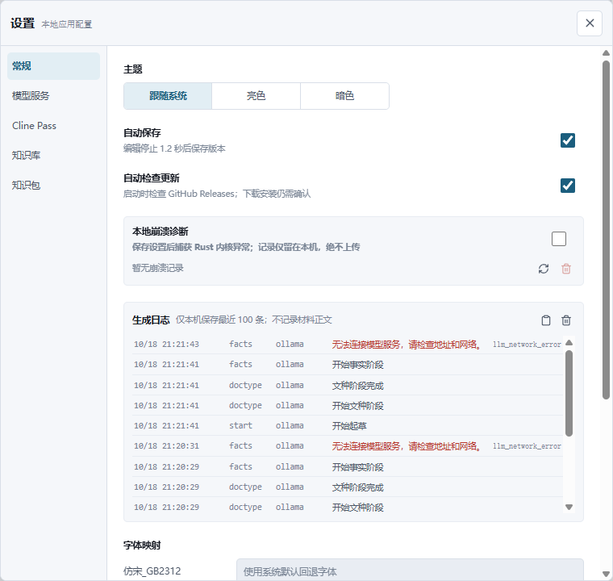

# 秉笔 · my-bingbi

> 中文公文写作工作台。跨平台桌面应用，对接私有 Obsidian 知识库，可插拔任意大模型。

把**规范**（GB/T 9704-2012 公文格式国标）、**语料**（你自己积累的历史公文库）、**模型**（可自由更换的大模型）三者打通，产出格式合规、事实可溯、少 AI 味、可直接交付的公文。



---

## 它解决什么问题

让通用大模型写公文，通常得到这样的东西：

> 为深入贯彻落实高质量发展要求，进一步凝心聚力、开拓创新、真抓实干，我单位持续强化责任担当，不断完善工作机制，全面推动各项工作走深走实、提质增效。

看着很正式，但谁负责、做了什么、通过什么机制、到什么节点、有什么结果——一个都没有。而且它随时可能编造一个文号、一笔金额、一份政策依据，这在公文里是事故级错误。

秉笔针对这两件事：

| | 做法 |
| --- | --- |
| **格式对不对** | 规则引擎按国标硬校验（字号、层次序数、六角括号〔〕、日期格式），毫秒级、零成本、结果可复现，不靠模型自觉 |
| **数据是不是编的** | 起草前先把材料结构化成事实台账，生成后逐项回查正文里的数字/日期/文号，**未命中的标红并阻断导出** |
| **像不像人写的** | 降 AI 味与 humanizer 二次审稿：意义膨胀、假深刻、模糊主体、规则三连、万能结论，能机检的走词表与正则，其余交模型评审 |
| **像不像本单位写的** | 从你的 Obsidian 库检索同文种历史件作参考，学本单位既有笔法，而非通用官腔 |
| **别人写的这份行不行** | 审核模式：打开或导入已有公文，规则硬校验 + 模型语义评审 + 评分量表，出一份可逐条定位的体检报告，**全程不改动原文** |

---

## 特性

- **跨平台** — Windows / Linux，Tauri 2 构建，安装包体积小、内存占用低
- **对接 Obsidian** — 主通道走 [Fast Note Sync Service](https://github.com/haierkeys/fast-note-sync-service) REST API，复用其 SQLite FTS5 全文检索与双链接口；WebSocket 增量订阅已接入（后台同步守护 + 设置页开关）；也支持直读 vault 目录离线兜底
- **知识库可选** — 知识库未配置时，写作台的「知识库」引用入口与「更多 → 归档」自动隐藏，界面只保留写作必需项；没有 Obsidian 也能用：一键创建本地 Markdown 知识库，在应用内新建资料并建立索引；在设置中启用后随配置出现，不打扰还没搭好库的用户
- **模型可插拔** — 内置 DeepSeek / Claude / Qwen / Kimi / 智谱 / 混元 / 千帆 / 硅基流动 / Gemini / OpenRouter / Groq / xAI / Mistral 等常用服务预设，也支持任意 OpenAI 兼容（vLLM、LM Studio、自建网关）与 Ollama 本地模型。可按流水线阶段分配不同模型：便宜模型做提取，强模型做起草
- **Cline Pass 订阅** — 对接 Cline Pass 网关，一个订阅使用 DeepSeek V4、GLM-5.x、Kimi K3、Qwen3.8 Max、MiniMax M3、MiMo 等国模；设置页可看 5 小时 / 每周 / 每月额度、切换模型、跳转订阅页，Key 只存系统凭据库
- **在线更新** — 启动时自动检查（可关），发现新版本在右上角提示；更新包用 minisign 公钥验签，Windows 走 NSIS、Linux 走 AppImage，安装后自动重启
- **材料驱动起草** — 只写大致意图、对象和时限即可，不要求先完成正文；参考文件可拖拽或点击上传 TXT / Markdown / CSV / JSON / YAML / PDF / OFD / DOC / DOCX / XLSX / XLS / WPS，主界面只显示文件名，文件内容在起草时作为隐藏引用材料送入流水线（Office/PDF 二进制文件由桌面内核解析）
- **写作台** — 打开就是一个大输入框：把要写的事、对象和时限说清楚即可；文种、标题与格式自动处理，模板、参考文件、知识库和模型都是可选小控件，不再先填一堆字段
- **模板库** — 22 个文种默认骨架 + 33 个场景模板（会议通知、整改报告、经费请示、动员讲话等），按文种过滤选择，起草时直接加载对应骨架
- **写作方法内置** — 文种路由、结构章法、规范句式、数字日期标点、降 AI 味、事实提取与质量量表以知识包参考材料注入对应阶段，不只是写在提示词里
- **单段改写** — 在正文编辑里对任意段落用当前模型改写，先预览再应用；数字、日期、文号有变化时必须勾选确认，不会悄悄改掉事实
- **快捷操作** — `Ctrl/⌘+K` 命令面板统一入口（写作台、保存、导出、审核、设置、主题、切换视图），最近文档支持按标题或文种搜索
- **涉密可控** — 密级达到秘密及以上时强制走本地模型，密钥存系统 Keyring，全本地存储，无遥测；WebView 启用严格 CSP（脚本仅限同源）
- **知识包机制** — 公文规范、文种模板、校验规则都是可装卸的 Skill Pack，设置页可启用/停用；用户包目录（`config_dir/packs`）支持自建"本单位公文包"，首个空目录自动放入 `local-corpus` 示例包
- **严格排版** — 按 GB/T 9704-2012 导出 docx：版心 156×225mm、天头 37mm、订口 28mm、行距 28pt 固定值、每面 22 行 × 28 字；支持机关 Word 模板注入；PDF 由内置 Typst 引擎零外部依赖生成（读取系统字体）
- **成本可见** — 每次起草/仿写/审核的 token 消耗按会话记录，最近文档可打开「起草记录」查看阶段明细
- **本地崩溃诊断** — 可选捕获 Rust 内核异常，只在本机 SQLite 中保留最近 100 条；设置页可查看、刷新和清空，不上传诊断数据

### 常用模型服务

设置 → 模型服务 →「常用服务」里选一个预设，表单会自动填好地址与默认模型；粘贴 API Key 后一次保存即可启用。预设只是模板，不会预先写入配置。

| 预设 | 默认地址 | 默认模型 |
| --- | --- | --- |
| 通义千问（DashScope） | `https://dashscope.aliyuncs.com/compatible-mode/v1` | `qwen-plus` |
| Kimi（Moonshot） | `https://api.moonshot.cn/v1` | `moonshot-v1-32k` |
| 智谱 GLM | `https://open.bigmodel.cn/api/paas/v4` | `glm-4-plus` |
| 腾讯混元 | `https://api.hunyuan.cloud.tencent.com/v1` | `hunyuan-turbos-latest` |
| 百度千帆（文心） | `https://qianfan.baidubce.com/v2` | `ernie-4.5-turbo-128k` |
| 硅基流动 | `https://api.siliconflow.cn/v1` | `deepseek-ai/DeepSeek-V3` |
| 讯飞星火 | `https://spark-api-open.xf-yun.com/v1` | `generalv3.5` |
| Google Gemini | `https://generativelanguage.googleapis.com/v1beta/openai` | `gemini-2.5-flash` |
| OpenRouter | `https://openrouter.ai/api/v1` | `openai/gpt-4o-mini` |
| Groq | `https://api.groq.com/openai/v1` | `llama-3.3-70b-versatile` |
| xAI Grok | `https://api.x.ai/v1` | `grok-3-mini` |
| Mistral | `https://api.mistral.ai/v1` | `mistral-small-latest` |
| LM Studio（本地） | `http://127.0.0.1:1234/v1` | `local-model` |
| vLLM / 自建（本地） | `http://127.0.0.1:8000/v1` | 部署时指定的模型名 |

模型名会随厂商更新，可在表单里直接改，或点「嗅探上游可用模型」。豆包（火山方舟）需要 `ep-` 接入点 ID，Azure OpenAI 使用 `api-key` 头而非 Bearer，两者暂未做预设，可用「新增模型服务」自行填写。



### Cline Pass 订阅

Cline Pass 是一个聚合订阅网关，一个 Key 可以使用 DeepSeek、GLM、Kimi、Qwen、MiniMax、MiMo 等一批国模。设置 → **Cline Pass**：

- 保存 API Key（写入系统 Keyring，界面只显示是否已保存）；
- 刷新并查看 5 小时 / 每周 / 每月额度与重置时间；
- 从订阅模型列表里搜索、切换当前模型，切换后自动启用 `cline-pass` 服务；
- 「打开订阅页」在系统浏览器打开 [cline.bot/cline-pass](https://cline.bot/cline-pass) 办理或管理订阅，应用内不承载支付页面。

网关地址为 `https://api.cline.bot/api/v1`，模型 ID 形如 `cline-pass/glm-5.3`。模型目录优先读取官方订阅列表与网关 `/models`，离线或接口不可用时回退到内置目录；额度读取的是 `/users/me/plan/usage-limits`。Key 与额度请求都只发生在 Rust 内核，WebView 不直接访问 Cline Pass。



### 建自己的知识库

知识库是可选组件。没有 Obsidian 或 FNS 时，可以直接在 **设置 → 知识库 → 本地 Vault** 里点「创建本地知识库」：应用会在配置目录下建立 `knowledge-base/`，并准备好 `收件箱/`、`政策/`、`公文/` 三个目录和一份说明文件。已有目录不会被覆盖。

建好后有三种使用方式：

- **直接上传材料**：在「添加资料」里选择文件（TXT、Markdown、CSV、JSON、YAML、PDF、OFD、DOC、DOCX、XLSX、XLS、WPS），桌面内核把可读文字转成 Markdown 存入 `收件箱/`；可以一次选多份，逐份显示解析进度，失败的文件会单独列出；
- **在应用内手动新建**：填写标题和正文，保存为 Markdown，勾选「保存后重建索引」即可立刻在写作台点「知识库」检索、引用；
- **用自己的文件**：把 Markdown 放进 `政策/` 或 `公文/`，或在 Obsidian 里继续编辑同一目录，回到设置点「重建索引」。



索引保存在本机 SQLite，原始笔记始终留在你的目录里，不会上传。FNS 与 MCP 仍保留给已经有远程库的用户：FNS 走 REST + WebSocket 增量同步，MCP 走 Bearer token；两者都只在明确配置后访问对应地址。

本地检索按标题和正文匹配，`收件箱/` 里的新资料、`政策/` 里的依据和 `公文/` 里的历史件都会出现在知识库弹窗。「更多 → 归档到知识库」可把当前公文写回知识库，作为下一次写作的参考件。

### 写作生成与失败排查

写作台点「开始写作」后，材料会直接进入完整流水线；输入框下方显示阶段进度（文种 → 事实 → 检索 → 骨架 → 起草 → 降 AI 味 → 校验 → 校对 → 回查 → 评分），生成完成自动切到版式预览，可继续在「编辑」里修改。失败时错误显示在输入框下方，当前模型与阶段名一并给出，可更换模型后重试。

每次起草都会写入本机的**生成日志**（设置 → 常规，最近 100 条）：开始/完成、阶段、模型服务、错误码，不记录材料正文。常见错误码：

- `llm_network_error`：模型地址不可达。用 Ollama 时先确认 `ollama serve` 已启动；云端服务检查地址、Key 与网络。
- `provider_auth_error`：Key 无效或无权限。
- `update_*` 只属于在线更新，不会出现在起草日志。

日志可一键复制，便于排查或反馈。



### 在线更新

应用启动后会读取 GitHub Releases 的 `latest.json`（`https://github.com/hellomrli/my-bingbi/releases/latest/download/latest.json`），有更新时在右上角提示，点「立即更新」才会下载安装。设置 → 常规 → 关于与更新 也可手动检查，并显示当前版本与发现的新版本。

- Windows 更新包为 NSIS 安装器，Linux 为 AppImage；两者都由发布流水线生成 `.sig` 并写入 `latest.json`。
- 更新公钥已固化在 `src-tauri/tauri.conf.json`，本地构建也能检查同一条签名通道；私钥只存在仓库 secret `TAURI_SIGNING_PRIVATE_KEY`。
- 校验失败、网络失败、清单缺少当前平台等错误会给出不同提示，不会把签名失败误报成"已是最新"。
- **只有发布比当前更高的版本才会提示更新**。当前 v1.1.7 已是最新；下一个更高版本发布后，v1.1.7 及更早版本即可收到。


发布新版本：同步提升 `package.json`、`src-tauri/tauri.conf.json` 和 `src-tauri/Cargo.toml` 的版本号，打 `vX.Y.Z` tag；release workflow 会构建、签名并上传安装器与 `latest.json`。公钥轮换时必须同时更新 `tauri.conf.json` 中的 `plugins.updater.pubkey` 和 `TAURI_SIGNING_PRIVATE_KEY` secret，否则旧版本无法验证新包。

### 写作台

写作台只保留一个输入框和一行可选控件：

- **文种**：默认「自动识别」；想固定文种时点「通知 / 请示 / 报告 / 总结 / 函 / 讲话稿」之一，避免模型路由摇摆。
- **参考文件 / 知识库**：都可跳过。参考文件区支持拖拽或点击添加 TXT、Markdown、CSV、JSON、YAML、PDF、OFD、DOC、DOCX、XLSX、XLS、WPS；添加后写作台只显示文件名和份数，不把全文粘贴进输入框，起草时才读取内容。知识库启用后可从历史公文里搜索引用，同样只显示资料名。
- **模型**：默认使用当前模型服务；没有配置时输入框下方会出现「配置模型」入口，不会阻塞先写材料。
- **文档信息**：发文字号、主送机关、落款、日期、密级都收在「更多 → 文档信息」里，全部可选，不填也能生成和导出。

生成后进入全宽文档页：「编辑」按段落修改，「版式」查看 GB/T 9704 版心预览；质检和事实台账收进右侧抽屉，不再常驻占用屏幕。


### 模板库与写作方法

模板分两层：每个文种有一份默认骨架（`templates/{doc_type}.yaml`），另有按场景细分的变体（如“会议通知”“工作部署通知”“经费请示”“整改报告”）。当前共 **55 份模板 / 22 个文种**：

| 文种 | 场景模板 |
| --- | --- |
| 通知 | 会议、工作部署、转发、任免、节假日安排 |
| 报告 | 情况、年度、整改 |
| 请示 | 申请经费、事项批准 |
| 函 | 商洽、复函、感谢 |
| 纪要 | 办公会、专题会 |
| 总结 | 年度、专项 |
| 讲话稿 | 动员、总结 |
| 方案 | 专项工作、实施方案 |
| 工作汇报 / 简报 / 议案 / 命令 / 公告 / 通告 / 批复 / 邀请函 / 证明 / 备忘录 / 发言稿 / 表彰决定 | 各有场景骨架 |

模板按文种在起草时自动加载；请求携带 `templateId`，内核只加载该模板的标题层级、固定称谓与结语。起草输出会按“一、/（一）/1.”解析回真实的 ODoc 标题与段落，不再把整篇正文塞进第一个段落。

写作方法来自多个开源 Skill 项目的提炼改写，已转成知识包参考材料并绑定到对应阶段：`document-type-router.md`（文种判断）、`structure.md` / `language.md`（结构、数字日期与标点）、`drafting-patterns.md` / `sentence-bank.md`（章法与句式）、`quantitative-style.md`（句长、顿号、标题与力度词节奏）、`fact-extraction.md` / `citation-policy.md`（事实台账与引用核验）、`humanizer.md`（降 AI 味）、`scoring-rubric.md`（评分量表）。内容为本地重写，不是原文照搬；来源与许可见各包 `THIRD_PARTY.md`。

### 改一段，不动全文

正文编辑里每个文字块都有「AI 改写」按钮。选一个目标（写具体 / 压缩 / 更规范 / 去 AI 味 / 只校对）和可选的补充要求，模型只改写这一段；结果先进入预览，确认后才写回文档。

改写提示带三条硬约束：不新增或修改数字、日期、文号、金额、单位、人名和机构名；不改变原意与段落功能；只输出正文。应用前还会对比原文与结果的数字、日期、文号：有新增或缺失时列出差异，必须勾选「我已核对上述变化」才能应用。改写使用当前选中的模型服务，涉密文档仍受「仅本地模型」限制。


### 命令面板与文档搜索

`Ctrl/⌘+K` 打开命令面板，统一执行写作台、新建、最近文档、保存、导出、打印、审核、Cline Pass、设置、切换主题和切换视图；支持方向键与 Enter。最近文档对话框可按标题或文种即时过滤，文档多时不用翻列表。


---

## 文档

| 文档 | 内容 |
| --- | --- |
| [`docs/PLAN.md`](docs/PLAN.md) | 项目计划：架构、模块拆解、数据模型、里程碑、风险 |
| [`docs/ODOC-SPEC.md`](docs/ODOC-SPEC.md) | ODoc 0.1 文档模型与兼容性规范 |
| [`docs/PACK-SPEC.md`](docs/PACK-SPEC.md) | 声明式知识包清单、规则与安全边界 |
| [`docs/STORE-SPEC.md`](docs/STORE-SPEC.md) | SQLite 事务、版本历史、配置和系统 Keyring 边界 |
| [`docs/ui/workbench.html`](docs/ui/workbench.html) | 界面设计稿（浏览器打开） |
| [`src/styles/tokens.css`](src/styles/tokens.css) | 设计令牌与 GB/T 9704-2012 版面常量 |
| [`CONTRIBUTING.md`](CONTRIBUTING.md) | 贡献指南：报告问题、提交代码、行为准则 |
| [`SECURITY.md`](SECURITY.md) | 安全策略：漏洞报告方式、数据边界与加固建议 |
| [`LICENSE`](LICENSE) | 开源协议（MIT） |

---

## 本地开发

要求 Node.js 20.19+（或 22.12+）、npm 10+、Rust 1.85+。先运行浏览器版工作台：

```bash
npm install
npm run dev
```

打开 `http://127.0.0.1:1420`。浏览器模式会使用与 Rust IPC 同结构的本地 ODoc 工厂，适合前端开发；草稿保存在浏览器本地存储。

运行测试和生产构建：

```bash
npm run check             # lint + typecheck + 单元测试（提交前跑这一条即可）
npm run lint              # ESLint（TypeScript + React Hooks 规则）
npm test                  # 前端单元测试（vitest + testing-library）
npm run test:e2e          # Playwright 端到端（浏览器模式）
npm run build             # tsc -b + vite build（同时做类型检查）
cd src-tauri
cargo test --workspace --exclude my-bingbi   # 除 Tauri 壳外的全部 crate（壳需桌面系统依赖，见下）
cargo clippy --workspace --exclude my-bingbi --all-targets -- -D warnings
cargo fmt --all -- --check
```

桌面版还需要 Tauri 2 的平台依赖。Ubuntu/Debian 安装 `libwebkit2gtk-4.1-dev`、`libayatana-appindicator3-dev`、`librsvg2-dev`、`libxdo-dev`、`libssl-dev`、`patchelf` 和构建工具后运行：

```bash
npm run tauri dev
```

修改 Rust 公共类型后重新生成前端声明：

```bash
cd src-tauri
cargo run -p odoc-model --example export_odoc_bindings
cargo run -p odoc-store --example export_store_bindings
cargo run -p odoc-llm --example export_llm_bindings
cargo run -p odoc-pack --example export_pack_bindings
cargo run -p odoc-lint --example export_lint_bindings
cargo run -p odoc-kb --example export_kb_bindings
cargo run -p odoc-engine --example export_engine_bindings
```

知识包和 `pipelines/draft.yaml` 会在桌面应用启动时从开发目录或安装包资源目录加载并校验。浏览器预览不读取本地知识包，也不会保存包内凭据；浏览器模式也不会发起模型调用。

---

## GitHub 发布

推送版本 tag 会自动在 GitHub Actions 的原生 runner 上构建 Linux `.deb` 和 Windows NSIS `.exe`，并创建对应的 GitHub Release：

```bash
git tag v1.1.7
git push origin v1.1.7
```

发布工作流位于 [`.github/workflows/release.yml`](.github/workflows/release.yml)，只匹配 `v*` tag；构建完成前不会创建 Release。

---

## 架构一览

```
前端  React + TypeScript          编辑器 / 版式预览 / 质检面板
  │   IPC
内核  Rust · Cargo Workspace
  ├─ odoc-model    公文文档模型（ODoc AST，全系统唯一真相源）
  ├─ odoc-pack     知识包加载
  ├─ odoc-llm      多模型适配（OpenAI 兼容 / Anthropic / Ollama）
  ├─ odoc-kb       知识库（FNS / 本地 vault / MCP）
  ├─ odoc-lint     规则引擎（确定性校验）
  ├─ odoc-export   docx / pdf 排版导出
  ├─ odoc-engine   流水线编排 + 事实台账
  ├─ odoc-store    SQLite + Keyring
  └─ src-tauri     Tauri 壳：commands/{document,export,config,kb,model,engine,lint,update}
```

起草流水线共十步，内核记录每阶段的输入快照，可单阶段重跑：

```
文种路由 → 事实提取 → 知识库检索 → 骨架生成 → 逐节起草
        → 降 AI 味 → 规则校验 → 文本校对 → 事实回查 → 质量评分
```

仿写流水线在检索与骨架之间多一步**笔法分析**：指定一篇范文，提炼其结构、句式、用词与惯用表述，再按新材料起草。

审核流水线共五步，只出意见、不改原文：

```
文种复核 → 规则校验 → 事实回查 → 语义评审 → 质量评分
```

---

## 快速开始

1. **首次运行**：桌面版会弹出三步引导（欢迎 → 选择模型服务 → 开始使用），设置页可随时重新查看。
2. **写一句想生成什么**：打开就是写作台，在输入框里写大致内容即可，例如“给各乡镇发防汛检查通知，下周开始，重点查值班和物资”。文种可自动识别，也可点一个可选文种；参考文件可直接拖到写作台，界面只显示文件名，起草时自动读取内容；知识库和模型也都是可选控件。标题、发文字号、署名、密级等全部收在「更多 → 文档信息」里，不填也能生成。
3. **生成**：点「开始写作」，材料会依次经过文种识别、事实提取、知识检索、骨架生成、正文起草、降 AI 味、规则校验、文本校对、事实回查和评分；完成后自动进入版式预览，点「编辑」按段落修改。
4. **质检与回查**：文档页右上角「质检」打开侧边抽屉，显示规则校验与事实回查结果；模型编造的数字/日期/文号标红，存在错误时导出被阻断。
5. **审核**：「更多 → 语义审核」对当前公文跑只读体检，报告可逐条定位到正文。
6. **交付**：导出符合 GB/T 9704-2012 的 DOCX（或 PDF / 打印），版本历史可 diff 与恢复。
7. **自定义规则**：把规则 YAML 写进用户包目录（设置 → 知识包页可见路径）中 `local-corpus` 示例包的 `rules/`，重启生效。

---

## 状态

**M0–M4 主线功能已闭环。** 当前已有可运行的 React 工作台、A4 国标版心预览、结构化正文编辑、确定性质检、事实台账与回查标红、最近文档、自动保存、版本快照与 diff、起草/仿写/审核三种流水线、单步重跑、会话成本记录、知识包管理、字体检测、首次运行引导、自定义规则与本地崩溃诊断；桌面版可导出 GB/T 9704 严格 docx（支持机关模板注入）与零依赖 PDF（内置 Typst 引擎）。Rust 侧已建立 Tauri 壳、`odoc-model` AST、`odoc-store` SQLite 持久化、`odoc-llm` 多 Provider、`odoc-kb`（FNS/本地 Vault/MCP + WebSocket 增量订阅）、`odoc-lint` 规则引擎与 `odoc-export` 排版。模型凭据只存系统 Keyring，秘密及以上公文在内核层禁止远程调用。Linux `.deb` 与本机验证、CI 原生 Linux/Windows 壳检查与安装包产物均已就绪。

**M0–M4 里程碑已完成。** v1.1.7 已于 2026-10-19 发布，GitHub Releases 提供 Linux（`.deb` / AppImage）与 Windows（NSIS `.exe`）安装包及 updater 清单；后续版本按 [`.github/workflows/release.yml`](.github/workflows/release.yml) 打 `v*` tag 发布（流程见 [`docs/PLAN.md` §9](docs/PLAN.md)）。可选增强：知识包在线安装与更新。

---

## 致谢

公文知识底座参考了多个开源 Skill 项目，互补覆盖格式、语言、量化节奏和工程流程：

- [KaguraNanaga/official-document-writing-skill](https://github.com/KaguraNanaga/official-document-writing-skill)（MIT）— GB/T 9704-2012 格式详解、文种模板、质量检查清单
- [Liuxiangjian-ai/official-document-skill](https://github.com/Liuxiangjian-ai/official-document-skill)（MIT）— 文种决策、人民日报表达规律、降 AI 味与 humanizer 审稿
- [larashero3-dotcom/lieflat-gongwen](https://github.com/larashero3-dotcom/lieflat-gongwen)（PolyForm Noncommercial 1.0.0）— 真实语料的句长、顿号、标题、力度词与收尾分布；本仓库只吸收统计口径与写作原则并本地重写
- [Rimagination/gongwen-draft](https://github.com/Rimagination/gongwen-draft)（仓库未附许可证）— 素材台账、来源优先级、引用核验、标点与易混词审核方法；本仓库只吸收方法并本地重写

本项目的工作是把其中**可机器判定**的部分从提示词转化为配置常量与校验规则，其余保留为按需检索的知识包。转换对照见 [`docs/PLAN.md` 附录](docs/PLAN.md)。上游非商用/未声明许可的内容若用于商业发行，请先自行评估适用性。
