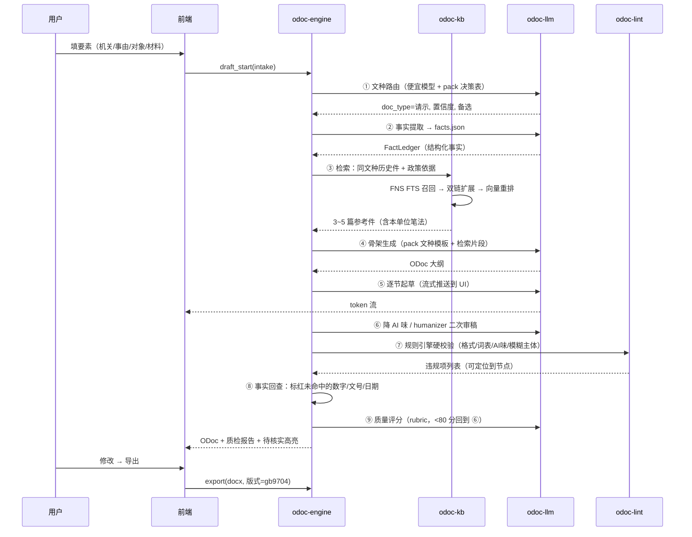

# my-wordediter 公文写作助手 — 项目计划

> 版本：v0.1（2026-08-12）
> 定位：一个**跨平台（Windows / Linux）、模块化、可对接私有 Obsidian 知识库、可插拔多家大模型**的中文公文写作桌面应用。

---

## 目录

1. [项目定位与目标](#1-项目定位与目标)
2. [参考项目分析](#2-参考项目分析)
3. [核心设计判断](#3-核心设计判断)
4. [总体架构](#4-总体架构)
5. [模块详解](#5-模块详解)
6. [关键数据模型](#6-关键数据模型)
7. [目录结构](#7-目录结构)
8. [跨平台方案](#8-跨平台方案)
9. [里程碑规划](#9-里程碑规划)
10. [风险与对策](#10-风险与对策)
11. [测试策略](#11-测试策略)
12. [待确认事项](#12-待确认事项)

---

## 1. 项目定位与目标

### 1.1 一句话定位

**面向体制内文字工作者的公文写作工作台**：把"规范"（GB/T 9704-2012 格式标准）、"语料"（你自己的 Obsidian 历史公文库）、"模型"（可插拔的任意大模型）三者打通，产出**格式合规、事实可溯、少 AI 味、可直接交付**的公文。

### 1.2 与参考项目的本质差异

两个参考项目都是**纯 Markdown 提示词包**，依赖 Claude Code / Cursor 这类宿主运行，能力边界是"生成一段文本"。本项目是**独立应用**，边界扩展到：

| 维度 | 参考项目（Skill 包） | 本项目 |
| --- | --- | --- |
| 运行形态 | 依附 AI 客户端 | 独立桌面应用，自带编辑器 |
| 格式规范 | 提示模型"应该这样排版" | **确定性校验 + 真实 docx 排版引擎** |
| 语料 | 无，靠模型记忆 | **对接你的 Obsidian 库，检索增强 + 仿写** |
| 模型 | 绑定宿主模型 | **Provider 可插拔，含本地 Ollama** |
| 质量控制 | 让模型自评打分 | **规则引擎硬校验 + 模型软评审双轨** |
| 防幻觉 | 提示"不要编造" | **事实白名单锁定 + 生成后回查标红** |
| 复用 | 不可复用 | **知识包（Skill Pack）机制，参考项目可直接装入** |

### 1.3 目标用户与核心场景

1. **起草**：给要素（发文机关、事由、对象、材料）→ 出可交付初稿。
2. **仿写**：从 Obsidian 库检索"去年的同类文件"→ 按本单位既有笔法生成。
3. **润色/降 AI 味**：粘贴一段"正确但空"的文字 → 改成具体、稳妥、能用的表达。
4. **审核**：导入已有公文 → 逐项体检（格式/语言/逻辑/细节）并给出修改意见。
5. **交付**：一键导出符合 GB/T 9704-2012 的 .docx（红头文件）/ PDF。

### 1.4 非目标（明确不做）

- 不做多人协同编辑、不做审批流 OA（可后续以插件形式接入）。
- 不做通用 Markdown 笔记软件（Obsidian 已经是了，我们只读写它）。
- 不做云端托管服务，**默认全本地运行**，仅模型调用出网（且可用本地模型完全断网）。

---

## 2. 参考项目分析

### 2.1 KaguraNanaga/official-document-writing-skill —— 规范侧

```
SKILL.md                             14 KB  主提示：五步流程、快速指南
references/gb-t-9704-2012-standard.md 18 KB  国标详解：版心/字体字号/版头版记/页码/特定格式
references/document-templates.md      43 KB  6 文种模板 + 30+ 实例 + 错误案例
references/writing-techniques.md      21 KB  语言四大原则、50+ 规范用语、标题"六看"、经验提炼四步法
checklists/quality-checklist.md       14 KB  100+ 项检查清单（格式/内容/语言/逻辑/细节/发文前确认）
```

**可提取的高价值资产**：

- **国标参数表**（版心 156×225mm、天头 37mm、订口 28mm、行距 28 磅、每面 22 行 × 28 字、各要素字体字号）→ 直接变成**排版引擎的配置常量**，而不是提示词。
- **结构层次序数规则**（一、黑体 → （一）楷体_GB2312 → 1. 仿宋 → （1）仿宋）→ 变成**文档模型的层级样式映射**。
- **100+ 项检查清单** → 拆成两部分：可机检的（字体字号、日期格式、发文字号六角括号〔〕、标点、数字用法）进**规则引擎**；需语义判断的（论证是否充分、层次是否合理）进**模型评审**。

### 2.2 Liuxiangjian-ai/official-document-skill —— 语言侧

```
SKILL.md   33 KB  20+ 文种决策表、格式规则、人民日报表达规律、
                  反 AI 味标准（事实密度/判断强度/句子节奏/抽象词控制/负面清单）、
                  humanizer 二次审稿、正向改写规则、11 类文种骨架、
                  内部评分 rubric（<80 分重写）、最终质检清单
tests.md    2 KB  5 个回归用例（文种识别/通知可执行性/报告不夹带请示/降 AI 味/风格边界）
```

**可提取的高价值资产**：

- **文种决策表**（场景 → 文种 → 结构 → 纪律）→ 变成**文种路由器**的知识底座。
- **反 AI 味负面清单**（意义膨胀、假深刻、模糊主体、规则三连、同义词轮换、元话语、万能结论）→ 大部分**可用正则/词表机检**，例如"走深走实""提质增效""凝心聚力"密度、"相关部门/有关方面"等模糊主体、三连排比结构。
- **内部评分 rubric** → 变成**质量评分模块**的输出 schema。
- **tests.md** → 变成**知识包回归测试**的模板，本项目要把它工程化（自动跑、自动判分）。

### 2.3 haierkeys/fast-note-sync-service（FNS）—— 你的知识库底座

Go + WebSocket + React 的自建笔记同步服务，配套 Obsidian 插件 `obsidian-fast-note-sync`。**它提供的能力远超预期，直接决定了知识库层的设计**：

| 能力 | 接口 | 对本项目的价值 |
| --- | --- | --- |
| **REST API** | `http://{host}:9000/api`，header `Authorization: {token}` | 主通道：读写笔记 |
| 笔记检索 | `GET /api/notes?vault=&keyword=&searchContent=&searchMode=path\|content\|regex` | **一级召回**，服务端已内建 SQLite **FTS5 全文检索** |
| 笔记读写 | `GET/POST/DELETE /api/note`、`append`/`prepend`/`replace`/`move`/`rename` | 生成的公文可**回写 Obsidian 库**归档 |
| 双链 | `GET /api/note/backlinks`、`/api/note/outlinks` | **图谱扩展召回**：命中一篇 → 顺着链接捞相关政策/前序文件 |
| Frontmatter | `PATCH /api/note/frontmatter` | 给归档公文自动打标（文种/年份/单位/密级） |
| 目录树 | `GET /api/folder/tree`、`/api/folder/notes` | 按文件夹限定检索范围（如只搜 `公文/2025/`） |
| 历史版本 | `GET /api/note/histories`、`/history/restore` | 公文修订留痕 |
| **MCP 原生** | StreamableHTTP `/api/mcp`、SSE `/api/mcp/sse`，`Authorization: Bearer <token>`，可选 `X-Default-Vault-Name` | **备用通道**，也是未来接其他知识源的统一形态 |
| WebSocket | 毫秒级变更分发 | **增量索引**：库里改了笔记，本地缓存实时失效重建 |

**结论**：知识库层不需要自己实现同步与全文检索，**优先走 FNS REST + WebSocket**，MCP 作为可选通道，本地 vault 目录直读作为离线兜底。三者用同一个 `KbProvider` trait 抽象。

---

## 3. 核心设计判断

这五条是整个架构的地基，后面所有模块都从这里推导。

### 判断一：公文不是 Markdown，必须有专用文档模型

公文有 Markdown 表达不了的强结构：版头（份号/密级/紧急程度/发文机关标志/发文字号/签发人）、主体（标题/主送/正文层次/附件说明/发文机关署名/成文日期/印章/附注）、版记（抄送/印发机关/印发日期）。层次序数还绑定字体（一、黑体 →（一）楷体 → 1. 仿宋）。

**用 Markdown 当内部格式会丢信息，导致排版校验和 docx 导出都做不准。**

→ 定义 **ODoc（Official Document Model）**：一棵 JSON AST，是编辑器、校验器、导出器、LLM 之间唯一的真相来源。Markdown / docx / 纯文本都只是它的**导入导出适配器**。

### 判断二：能机检的绝不烧 token

参考项目把"检查发文字号是否用六角括号〔〕"这种事交给大模型，既慢、又贵、还不稳定（同一份文档两次检查结果可能不同）。

→ **双轨质检**：
- **规则引擎（确定性）**：格式要素、字体字号、日期/数字/标点用法、发文字号、禁用词表、AI 味词频、模糊主体、三连排比密度。毫秒级、零成本、结果可复现。
- **模型评审（语义）**：论证是否充分、文种是否用错、判断是否有证据支撑、段落功能是否明确、整体评分。

规则引擎的规则来自知识包的 `rules/*.yaml`，用户可自行增删（比如加入本单位的禁用表述）。

### 判断三：防幻觉靠"事实白名单"，不靠提示词

公文里编造一个文号、一个日期、一笔金额，是**事故级**错误。ref2 只能在提示词里写 "Never invent numbers"，无法保证。

→ **事实锁定机制（Fact Ledger）**：
1. 起草前先做**事实提取**，把用户提供的材料结构化成 `facts.json`（主体、客体、动作、机制、数据、时间、地点、问题、结果、责任、时限、反馈路径、政策依据）。
2. 生成后做**回查**：扫描正文中所有数字、日期、文号（正则 `〔\d{4}〕\d+号`）、机构名、人名，逐一比对 `facts.json`。
3. **未命中的一律标红**，UI 上高亮为"待核实"，并阻止导出（可强制覆盖，但要用户显式确认）。

这是本项目相对参考项目最实质的能力提升。

### 判断四：知识包（Skill Pack）机制，让参考项目变成可装卸的插件

不要把 ref1/ref2 的内容硬编码进代码。定义一套包格式，两个参考项目**稍作转换即可直接装入**，用户也能自建"本单位公文包"。

### 判断五：流水线可配置，而不是一次性大提示词

ref2 的工作流已经是流水线（识别场景 → 判断文种 → 提取事实 → 匹配结构 → 生成正文 → 降 AI 味 → 质量评分 → 交付），但塞在一个提示词里让模型自己走。

→ **显式编排**：每个 stage 是独立的一次模型调用，有自己的输入/输出 schema、提示片段来源、是否检索知识库、用哪个模型（便宜模型做提取、强模型做起草）。流水线定义在 YAML 里，可替换、可插入自定义 stage、单步可重跑。

---

## 4. 总体架构

### 4.1 分层图

```
┌──────────────────────────────────────────────────────────────────┐
│  前端 (src/)  React + TypeScript + Vite                          │
│  ┌────────────┬────────────┬────────────┬────────────┬────────┐ │
│  │ 要素表单   │ 结构化编辑器│ 版式预览   │ 质检面板   │ 素材侧栏│ │
│  │ (Intake)   │ (TipTap)   │ (A4 分页)  │ (双轨结果) │ (KB)   │ │
│  └────────────┴────────────┴────────────┴────────────┴────────┘ │
│                     状态: Zustand   通信: Tauri invoke / Channel │
└────────────────────────────┬─────────────────────────────────────┘
                             │  IPC (命令 + 流式事件)
┌────────────────────────────┴─────────────────────────────────────┐
│  内核 (src-tauri/)  Rust · Cargo Workspace                       │
│                                                                   │
│  ┌─────────────────────────────────────────────────────────────┐ │
│  │ odoc-engine   编排层：流水线调度、事实台账、会话与版本管理    │ │
│  └───┬─────────┬──────────┬──────────┬──────────┬──────────────┘ │
│      │         │          │          │          │                │
│  ┌───┴───┐ ┌───┴────┐ ┌───┴────┐ ┌───┴────┐ ┌───┴─────┐         │
│  │odoc-  │ │odoc-llm│ │ odoc-kb│ │odoc-   │ │odoc-    │         │
│  │model  │ │        │ │        │ │lint    │ │export   │         │
│  │文档AST│ │多模型  │ │知识库  │ │规则引擎│ │docx/pdf │         │
│  └───────┘ └───┬────┘ └───┬────┘ └───┬────┘ └─────────┘         │
│                │          │          │                           │
│           ┌────┴────┐ ┌───┴────┐ ┌───┴────┐                      │
│           │Provider │ │Provider│ │ rules  │   ┌──────────────┐   │
│           │·OpenAI兼│ │·FNS    │ │ *.yaml │   │ odoc-pack    │   │
│           │·Anthropic│ │·Local  │ └────────┘   │ 知识包加载器 │   │
│           │·Ollama  │ │·MCP    │              └──────────────┘   │
│           └─────────┘ └────────┘                                 │
│                                                                   │
│  存储: SQLite (rusqlite) + 系统 Keyring (密钥)                    │
└───────────────────────────────────────────────────────────────────┘
         │                    │                        │
    ┌────┴─────┐        ┌─────┴──────┐          ┌──────┴──────┐
    │ 大模型   │        │ FNS 服务   │          │ packs/      │
    │ API/本地 │        │ :9000      │          │ 知识包目录  │
    └──────────┘        └─────┬──────┘          └─────────────┘
                              │ 同步
                        ┌─────┴──────┐
                        │ Obsidian库 │
                        └────────────┘
```

### 4.2 一次"起草"的完整数据流



---

## 5. 模块详解

### 5.1 `odoc-model` — 文档模型（地基，最先做）

**职责**：定义 ODoc AST、层次样式映射、序列化、Markdown/纯文本互转、增量补丁（用于流式生成）。

**核心类型（Rust）**：

```rust
pub struct ODoc {
    pub meta: DocMeta,          // 文种、密级、紧急程度、份号
    pub header: Option<Header>, // 版头：发文机关标志、发文字号、签发人
    pub body: Body,             // 主体
    pub footer: Option<Footer>, // 版记：抄送、印发机关、印发日期
    pub facts: FactLedger,      // 事实台账（判断三）
    pub provenance: Vec<Cite>,  // 每段的来源：模型生成 / 检索引用 / 用户手写
}

pub struct Body {
    pub title: Title,                    // 标题（发文机关+事由+文种）
    pub main_recipient: Vec<String>,     // 主送机关
    pub blocks: Vec<Block>,              // 正文块
    pub attachments: Vec<Attachment>,    // 附件说明
    pub signer: Option<Signer>,          // 发文机关署名
    pub date: Option<OfficialDate>,      // 成文日期
    pub note: Option<String>,            // 附注
}

pub enum Block {
    Heading { level: HeadingLevel, text: Inline },  // 层次序数
    Paragraph(Inline),
    List { style: ListStyle, items: Vec<Block> },
    Table(Table),
    Quote(Inline),
}

/// 层次序数 → 字体绑定（来自 GB/T 9704-2012）
pub enum HeadingLevel {
    L1,  // 一、      黑体 3 号
    L2,  // （一）    楷体_GB2312 3 号
    L3,  // 1.        仿宋_GB2312 3 号
    L4,  // （1）     仿宋_GB2312 3 号
}
```

**关键点**：
- 每个节点带稳定 `id`，让质检结果能精确定位到 UI 上某一段，点击即跳转。
- `provenance` 记录每段来源，用于"这句话是编的还是有出处"的溯源展示。
- 流式生成用 **JSON Patch** 增量下发，避免每个 token 重传整棵树。

### 5.2 `odoc-pack` — 知识包机制

**包格式**：

```
packs/<pack-id>/
├── pack.toml              # 元数据 + 能力声明 + stage 绑定
├── SKILL.md               # 主提示（兼容 Anthropic Skill frontmatter，可直接放 ref1/ref2 的）
├── references/*.md        # 按需加载的参考资料（大文件，检索式加载而非全量入 prompt）
├── checklists/*.md        # 人读清单
├── templates/<文种>.yaml  # 文种骨架（结构化，非纯文本）
├── rules/*.yaml           # 机检规则（喂给 odoc-lint）
├── style/*.toml           # 版式参数（喂给 odoc-export）
└── tests/*.yaml           # 回归用例
```

**`pack.toml` 示例**：

```toml
[pack]
id = "gb9704-format"
name = "GB/T 9704-2012 格式规范包"
version = "1.0.0"
source = "https://github.com/KaguraNanaga/official-document-writing-skill"
license = "MIT"

[capabilities]
doc_types = ["请示","通知","函","报告","总结","纪要"]
provides  = ["format_rules","templates","checklists","style"]

# 把包内资源绑定到流水线的哪一步
[[bindings]]
stage  = "outline"
inject = ["templates/{doc_type}.yaml"]

[[bindings]]
stage  = "lint"
rules  = ["rules/format.yaml","rules/punctuation.yaml"]

[[bindings]]
stage  = "review"
inject = ["checklists/quality-checklist.md"]
retrieval = true   # 大文件不全量注入，按需检索片段
```

**规则文件示例**（把 ref1 检查清单 + ref2 负面清单机械化）：

```yaml
# rules/anti-ai.yaml  —— 来自 ref2 的负面清单
- id: slogan-density
  name: 口号密度过高
  severity: warn
  type: lexicon_density
  lexicon: ["走深走实","提质增效","凝心聚力","开拓创新","真抓实干",
            "落地见效","持续发力","全面推动","不断完善","进一步强化"]
  max_per_100_chars: 1
  message: "抽象口号密度超标，请替换为主体、任务、机制、时限"

- id: vague-actor
  name: 模糊主体
  severity: error
  type: regex
  pattern: "(相关部门|有关方面|各有关单位)(?!.{0,20}(具体|即|由))"
  message: "未指明责任对象，公文须明确到具体单位"

- id: rule-of-three
  name: 规则三连包装
  severity: warn
  type: structure
  detect: parallel_phrases
  min_run: 3
  message: "连续三连排比是典型 AI 腔，除非各项确有实指"

# rules/format.yaml —— 来自 ref1 国标
- id: wenhao-bracket
  name: 发文字号须用六角括号
  severity: error
  type: regex
  scope: header.doc_number
  pattern: "[\\[【]\\d{4}[\\]】]"
  message: "年份须用六角括号〔〕，不得用方括号或中括号"

- id: date-arabic-full
  name: 成文日期用阿拉伯数字全称
  severity: error
  type: regex
  scope: body.date
  pattern: "^\\d{4}年\\d{1,2}月\\d{1,2}日$"
  negate: false
```

**首批内置三个包**：
1. `gb9704-format`（转自 ref1）—— 规范与模板
2. `renmin-style`（转自 ref2）—— 语言与降 AI 味
3. `local-corpus`（自建，空壳）—— 用户本单位的笔法与禁用语，从 Obsidian 库自动蒸馏

### 5.3 `odoc-llm` — 多模型适配层

**统一抽象**：

```rust
#[async_trait]
pub trait LlmProvider: Send + Sync {
    fn id(&self) -> &str;
    fn capabilities(&self) -> Capabilities;  // 流式/工具调用/JSON模式/上下文长度/是否本地
    async fn chat(&self, req: ChatRequest) -> Result<ChatResponse>;
    async fn chat_stream(&self, req: ChatRequest, tx: Sender<Delta>) -> Result<()>;
    async fn embed(&self, texts: &[String]) -> Result<Vec<Vec<f32>>>;  // 可选
}
```

**内置 Provider**：

| Provider | 说明 | 覆盖 |
| --- | --- | --- |
| `openai-compatible` | `/v1/chat/completions`，**base_url 可配** | DeepSeek、通义千问兼容模式、Kimi、智谱、MiniMax、硅基流动、vLLM 自建 |
| `anthropic` | Messages API | Claude 系列 |
| `ollama` | `/api/chat` | 本地模型，**涉密场景必选** |
| `gemini` | 可选，M3 再加 | |

**关键设计**：
- **模型不写死在代码里**，用户在设置界面填 `base_url + api_key + model_name` 即可新增，配置存 `providers.toml`。
- **按 stage 分配模型**：文种路由/事实提取用便宜快模型，起草/降 AI 味用强模型，评分用中等模型。配置示例：
  ```yaml
  stages:
    doctype:  { provider: deepseek, model: deepseek-chat, temperature: 0 }
    facts:    { provider: deepseek, model: deepseek-chat, temperature: 0, json_mode: true }
    draft:    { provider: anthropic, model: claude-sonnet-5, temperature: 0.4 }
    deai:     { provider: anthropic, model: claude-sonnet-5, temperature: 0.6 }
    score:    { provider: deepseek, model: deepseek-chat, temperature: 0, json_mode: true }
  ```
- **密钥存系统 Keyring**（Windows Credential Manager / Linux Secret Service），**绝不明文落盘**。
- **统一重试/超时/限流/成本统计**，UI 上显示本次起草消耗了多少 token、多少钱。
- **涉密拦截**：文档标了"秘密"及以上密级时，**非本地 Provider 直接禁用**，强制走 Ollama，UI 明确提示。

### 5.4 `odoc-kb` — 知识库层（Obsidian 对接）

**统一抽象**：

```rust
#[async_trait]
pub trait KbProvider: Send + Sync {
    async fn search(&self, q: &Query) -> Result<Vec<Hit>>;
    async fn get(&self, path: &str) -> Result<Note>;
    async fn backlinks(&self, path: &str) -> Result<Vec<String>>;
    async fn outlinks(&self, path: &str) -> Result<Vec<String>>;
    async fn write(&self, path: &str, content: &str) -> Result<()>;      // 归档回写
    async fn patch_frontmatter(&self, path: &str, kv: Map) -> Result<()>; // 自动打标
    fn watch(&self) -> Option<Receiver<ChangeEvent>>;                     // 增量索引
}
```

**三个实现**：

| 实现 | 通道 | 用途 |
| --- | --- | --- |
| **`FnsProvider`（主）** | REST `:9000/api` + WebSocket | 你的实际部署形态，多端一致，服务端已有 FTS5 |
| `LocalVaultProvider` | 直读 vault 目录 | 离线兜底 / 未部署 FNS 的用户；自行解析 frontmatter、`[[wikilink]]`、`#tag` |
| `McpProvider` | StreamableHTTP `/api/mcp` | 通用通道，未来接其他知识源（企业文档库等） |

**FNS 接口映射**：

```rust
// search  → GET /api/notes?vault=&keyword=&searchContent=true&searchMode=content
//           &sortBy=&page=&pageSize=      （服务端 SQLite FTS5）
// get     → GET /api/note?vault=&path=
// backlinks/outlinks → GET /api/note/backlinks | /outlinks
// write   → POST /api/note                （生成的公文归档回库）
// patch_frontmatter → PATCH /api/note/frontmatter
// 目录限定 → GET /api/folder/notes         （只搜 公文/2025/ 之类）
// watch   → WebSocket 变更分发             （毫秒级，用于本地缓存失效）
// 认证    → header: Authorization: {token}
```

**三级检索管线**（混合召回，比单纯向量检索更适合公文场景）：

```
① 关键词召回   FNS FTS5 全文检索 + 目录/frontmatter 过滤（文种、年份、单位、密级）
       ↓  Top 50
② 图谱扩展     顺 backlinks/outlinks 各扩一跳（捞出被引用的政策依据、前序文件）
       ↓  Top 80
③ 语义重排     本地 embedding（fastembed-rs，bge-small-zh）计算相似度
               RRF 融合 ①③ 排名
       ↓  Top 5
④ 片段裁剪     只取相关章节而非整篇，控制上下文长度
```

**本地缓存**：SQLite（`sqlite-vec` 存向量 + 自建 FTS 兜底），WebSocket 事件驱动增量更新。首次全量索引在后台跑，带进度条。

**素材库自动打标**：扫描 Obsidian 库时，用便宜模型给历史公文自动补 frontmatter（`doc_type`、`year`、`issuer`、`topic`、`security_level`），写回库里（用户可关闭）。打标后检索精度大幅提升，也让用户的 Obsidian 库本身变得更有序。

### 5.5 `odoc-lint` — 规则引擎（确定性质检）

**职责**：加载知识包的 `rules/*.yaml`，对 ODoc 做零成本、可复现的硬校验。

**规则类型**：

| 类型 | 说明 | 例子 |
| --- | --- | --- |
| `regex` | 正则匹配/反匹配，可限定作用域 | 发文字号六角括号、成文日期格式 |
| `lexicon_density` | 词表密度阈值 | 口号密度、抽象词控制 |
| `structure` | 结构检测 | 三连排比、层次序数跳级、请示多头主送 |
| `format` | 版式要素 | 字体字号绑定、必填要素缺失 |
| `fact_check` | 事实回查（判断三） | 未在 FactLedger 中的数字/文号/日期 |
| `custom` | WASM/脚本扩展（M4） | 本单位特殊规则 |

**输出**：

```rust
pub struct Finding {
    pub rule_id: String,
    pub severity: Severity,   // error 阻断导出 / warn 提示 / info 建议
    pub node_id: String,      // 精确定位到 ODoc 节点，UI 点击跳转
    pub range: Option<(usize, usize)>,
    pub message: String,
    pub suggestion: Option<String>,  // 可一键应用的修复
}
```

**UI 呈现**：右侧质检面板按 error/warn/info 分组，点击定位到正文并高亮，有 `suggestion` 的显示"一键修复"。存在 `error` 时导出按钮禁用（可显式覆盖）。

### 5.6 `odoc-engine` — 编排层

**流水线定义**（YAML，可配置、可插入自定义 stage）：

```yaml
# pipelines/draft.yaml
name: 标准起草流程
stages:
  - id: doctype
    type: llm
    prompt: pack://renmin-style#document-type-decision
    output_schema: DocTypeDecision
    on_low_confidence: ask_user        # 置信度低时弹窗让用户确认文种

  - id: facts
    type: llm
    prompt: pack://renmin-style#fact-extraction
    output_schema: FactLedger
    json_mode: true

  - id: retrieve
    type: kb
    query_from: [facts, doctype]
    filters: { doc_type: "{doctype.value}", folder: "公文/" }
    top_k: 5

  - id: outline
    type: llm
    inject: [pack://gb9704-format#templates/{doctype.value}, retrieve.hits]
    output_schema: ODocOutline

  - id: draft
    type: llm
    stream: true                        # 流式推送到编辑器
    inject: [outline, facts, retrieve.hits]

  - id: deai
    type: llm
    prompt: pack://renmin-style#humanizer-pass

  - id: lint
    type: rules                         # 零成本硬校验
    packs: [gb9704-format, renmin-style, local-corpus]

  - id: factcheck
    type: fact_verify                   # 事实回查，标红

  - id: score
    type: llm
    prompt: pack://renmin-style#internal-scoring-rubric
    output_schema: Score
    loop_back:                          # 分数不达标自动回炉
      when: "score.total < 80"
      to: deai
      max_iterations: 2
```

**其他职责**：
- **会话与版本**：每次起草是一个 Session，每个 stage 的输入输出全部落 SQLite，支持**单步重跑**（改了提示词只重跑那一步，不用全流程重来）和版本对比（diff 视图）。
- **成本核算**：按 stage 统计 token 与费用。
- **取消与恢复**：长流程可中断，断点续跑。

**其他流水线**：`polish.yaml`（润色/降 AI 味）、`review.yaml`（审核已有公文，已实现）、`imitate.yaml`（仿写指定范文）。

流水线用 `kind` 区分阶段集合：`draft`（默认，向后兼容不写该字段的旧定义）必须含 `doctype`/`facts`/`outline`/`draft`；`review` 必须含 `doctype`/`lint`/`factcheck`/`review`/`score`，且**禁止声明任何会改写文档的阶段**（`facts`/`outline`/`draft`/`deai`/`export`）——审核只出意见，不动原文，这条边界在内核校验层强制，而不是靠提示词约束。

### 5.7 `odoc-export` — 排版导出

这是**分阶段**做的（按你的选择）。

**M1 阶段：预览优先**
- 前端用 CSS 实现 A4 分页预览：`@page` + mm 单位，版心 156×225mm、天头 37mm、订口 28mm，字号按国标映射（3 号 = 16pt，2 号 = 22pt），行距 28 磅固定值，校验"每面 22 行 × 28 字"。
- 导出：ODoc → HTML → Tauri WebView 打印 → PDF。快速可用。
- 导出简化 docx（结构正确、样式基础）用于交换。

**M2 阶段：严格 docx 排版引擎**
- Rust 侧用 `docx-rs` 构建，版式参数从知识包 `style/gb9704.toml` 读取：

```toml
[page]
size = "A4"           # 210 × 297 mm
margin_top = 37       # 天头（mm）
margin_left = 28      # 订口（mm）
body_width = 156
body_height = 225
line_spacing_pt = 28  # 固定行距
lines_per_page = 22
chars_per_line = 28

[fonts]
title        = { font = "方正小标宋简体", size_pt = 22 }  # 2号
body         = { font = "仿宋_GB2312",   size_pt = 16 }  # 3号
heading_l1   = { font = "黑体",          size_pt = 16 }
heading_l2   = { font = "楷体_GB2312",   size_pt = 16 }
heading_l3   = { font = "仿宋_GB2312",   size_pt = 16 }
doc_number   = { font = "仿宋_GB2312",   size_pt = 16 }

[header]
org_mark_color = "#FF0000"    # 发文机关标志红色
separator_line = true          # 红色分隔线
```

- **双轨保险**：纯生成（docx-rs）为主；同时支持**模板注入法**——用预先在 Word 里做好页面设置和样式的 `.docx` 模板，程序只填内容并套用样式名。模板法对红头、版记分隔线这类难点更保真，作为兜底和用户自定义机关模板的入口。
- **PDF**：可选调用本地 LibreOffice headless（`soffice --convert-to pdf`）做高保真转换，检测不到则回退到 WebView 打印。

**导入**：docx → ODoc（用于"审核已有公文"场景），基于 OOXML 解析，尽力还原层次结构。

---

## 6. 关键数据模型

### 6.1 FactLedger（事实台账）

```jsonc
{
  "subject":   "县应急管理局",           // 主体
  "object":    "各乡镇（街道）",          // 客体
  "action":    "申请购置应急排水设备经费",
  "data":      [{"value": "15", "unit": "万元", "source": "user_input"},
                {"value": "3", "unit": "台", "source": "user_input"}],
  "time":      [{"value": "2026年9月30日", "role": "deadline", "source": "user_input"}],
  "place":     "全县12个乡镇",
  "problem":   "现有排水设备老化，近期强降雨增多",
  "basis":     [],                        // 政策依据：空 = 不得编造
  "responsibility": "县应急管理局装备科",
  "feedback":  "妥否，请批示"
}
```

`source` 字段区分 `user_input`（用户提供，可信）/ `kb_retrieved`（库中检索，附出处路径）/ `model_generated`（模型生成，**必须标红待核实**）。

### 6.2 本地 SQLite Schema（概要）

```sql
documents(id, title, doc_type, odoc_json, status, created_at, updated_at)
doc_versions(id, doc_id, seq, odoc_json, stage, created_at)     -- 版本留痕
sessions(id, doc_id, pipeline, state, cost_tokens, cost_money)
stage_runs(id, session_id, stage_id, input_json, output_json, provider, tokens, ms)
kb_notes(path, vault, title, frontmatter_json, mtime, hash)      -- 索引缓存
kb_chunks(id, path, seq, text, embedding BLOB)                   -- 向量（sqlite-vec）
kb_fts(path, title, content)                                     -- FTS5 本地兜底
findings(id, doc_id, rule_id, severity, node_id, message)
providers(id, kind, base_url, model, enabled)                    -- 密钥不在此，走 Keyring
```

---

## 7. 目录结构

```
my-wordediter/
├── README.md
├── docs/
│   ├── PLAN.md                    # 本文件
│   ├── ARCHITECTURE.md            # 详细设计（M0 产出）
│   ├── PACK-SPEC.md               # 知识包格式规范
│   └── ODOC-SPEC.md               # 文档模型规范
│
├── src-tauri/                     # Rust 内核（Cargo workspace）
│   ├── Cargo.toml                 # [workspace] members
│   ├── tauri.conf.json
│   ├── src/                       # Tauri 壳：命令注册、窗口、菜单、托盘
│   │   ├── main.rs
│   │   └── commands/              # IPC 命令：draft/export/kb/settings
│   └── crates/
│       ├── odoc-model/            # ① 文档模型 AST（无依赖，最先做）
│       ├── odoc-pack/             # ② 知识包加载与解析
│       ├── odoc-llm/              # ③ 多模型适配
│       │   └── src/providers/     #    openai_compatible.rs / anthropic.rs / ollama.rs
│       ├── odoc-kb/               # ④ 知识库
│       │   └── src/providers/     #    fns.rs / local_vault.rs / mcp.rs
│       ├── odoc-lint/             # ⑤ 规则引擎
│       ├── odoc-export/           # ⑥ docx / pdf 导出
│       ├── odoc-engine/           # ⑦ 流水线编排
│       └── odoc-store/            # ⑧ SQLite 存储 + Keyring
│
├── src/                           # 前端（React + TS + Vite）
│   ├── main.tsx
│   ├── features/
│   │   ├── intake/                # 要素表单
│   │   ├── editor/                # TipTap 结构化编辑器 + ODoc 节点定义
│   │   ├── preview/               # A4 版式分页预览
│   │   ├── lint-panel/            # 质检面板
│   │   ├── kb-sidebar/            # 素材/检索侧栏
│   │   └── settings/              # 模型、知识库、知识包配置
│   ├── lib/
│   │   ├── ipc.ts                 # Tauri invoke 封装
│   │   └── odoc.ts                # ODoc TS 类型（由 Rust 用 ts-rs 自动生成）
│   └── styles/gb9704.css          # 版式样式
│
├── packs/                         # 知识包
│   ├── gb9704-format/             # 转自 KaguraNanaga（规范侧）
│   ├── renmin-style/              # 转自 Liuxiangjian-ai（语言侧）
│   └── local-corpus/              # 用户本单位包（从 Obsidian 蒸馏）
│
├── pipelines/                     # 流水线定义
│   ├── draft.yaml  polish.yaml  review.yaml  imitate.yaml
│
├── templates/docx/                # 机关红头 Word 模板（模板注入法）
│
└── .github/workflows/
    ├── ci.yml                     # test + clippy + fmt（linux/windows matrix）
    └── release.yml                # 打包：Windows MSI/NSIS + Linux AppImage/deb
```

**类型同步**：Rust 侧用 `ts-rs` 从 `odoc-model` 自动导出 TypeScript 类型到 `src/lib/odoc.ts`，前后端模型永不漂移。

---

## 8. 跨平台方案

### 8.1 打包分发

| 平台 | 运行时 | 产物 | 备注 |
| --- | --- | --- | --- |
| Windows 10/11 | WebView2（系统自带或引导安装） | `.msi` + `.exe`(NSIS) | 主战场，公文最终在 Word 里定稿 |
| Linux | WebKitGTK 4.1 | `.AppImage` + `.deb` | AppImage 免装依赖，优先推荐 |

CI 用 GitHub Actions matrix（`windows-latest` + `ubuntu-22.04`）交叉产出，自动 release。

### 8.2 中文公文字体 —— 必须提前处理的坑

**问题**：GB/T 9704-2012 要求 `仿宋_GB2312`、`楷体_GB2312`、`方正小标宋简体`。**Linux 上默认全都没有**，Windows 上 `仿宋_GB2312` 也未必装（新版 Windows 只带"仿宋"）。这些字体多数**有版权，不能随应用分发**。

**方案（三层）**：

1. **预览层**：应用内置**开源替代字体**（Noto Serif CJK SC / 思源宋体、霞鹜文楷等），做屏幕预览和分页计算。UI 明确标注"预览字体为替代字体，最终交付以 Word 渲染为准"。
2. **导出层**：docx 里**照实写入 `仿宋_GB2312` 等标准字体名**（同时设置 `w:eastAsia` 与 `w:ascii`），文件带到装有正版字体的 Windows/Word 环境即完全正确。**这是关键**——排版正确性由字体名保证，不由本机是否有字体保证。
3. **检测与引导**：启动时检测系统字体，缺失时给出提示与安装指引（Windows 指向系统字体包，Linux 提供 `fc-cache` 安装说明），并允许用户在设置里做字体映射（`仿宋_GB2312 → 本机某字体`）。

**分页计算的准确性**：因为预览用替代字体，"每面 22 行 × 28 字"的计算不能靠实际渲染测量，要**按国标参数算**（中文全角字符按字号宽度计算，西文/数字按半角折算），这样在任何平台上分页结果一致。

### 8.3 路径与配置

- 配置目录用 `directories` crate：Windows `%APPDATA%\my-wordediter\`，Linux `~/.config/my-wordediter/`。
- 所有路径处理走 `PathBuf`，禁止手拼 `/`。
- 换行符：内部统一 `\n`，导出 Windows 目标时转 `\r\n`。

---

## 9. 里程碑规划

假设单人开发，时间为粗估。**每个里程碑都要求可运行、可演示**。

### M0 — 骨架与规范（约 2 周）

- [ ] Tauri 2 + React + Vite 工程搭起来，两平台各出一个能跑的包（CI 打通）
- [x] `odoc-model` 定义完成，`ODOC-SPEC.md` 写清楚，`ts-rs` 类型导出打通
- [x] `PACK-SPEC.md` 知识包格式定稿
- [x] SQLite 初始化、配置读写、Keyring 打通
- **验收进度**：空 ODoc、前后端类型一致、Linux `.deb` 已在本机验证；Windows 原生构建与 NSIS 安装包已纳入 Windows CI，待首次 CI 运行产出安装包后完成双平台验收。

### M1 — 最小可用闭环（约 4 周）

- [x] `odoc-llm`：OpenAI 兼容 + Ollama 两个 Provider，流式输出打通
- [x] `odoc-pack`：把 ref1/ref2 转成 `gb9704-format`、`renmin-style` 两个包；桌面启动时校验并加载，安装包内资源映射到 `packs/`
- [x] `odoc-engine`：`draft.yaml` 流水线跑通（文种路由 → 事实提取 → 骨架 → 起草）；已接入 SQLite 会话日志、流式 Tauri IPC 与密级边界
- [x] 前端：要素表单 + 结构化编辑器 + A4 版式预览；已接入材料输入、Provider 选择、流式起草和低置信度文种确认
- [x] `odoc-lint`：知识包规则引擎 + 事实回查；已接入 `lint`/`factcheck` stage 和右侧质检面板
- [x] 导出：桌面版简化 DOCX（OOXML ZIP + GB/T 9704 页面参数 + 内核 lint/factcheck 阻断）；PDF/WebView 打印待补
- **验收**：输入"申请购置应急排水设备经费，15 万元，设备老化，强降雨"→ 出一份格式正确的**请示**，质检面板能报出问题，桌面版可导出简化 DOCX（PDF 待补）

### M2 — 知识库与严格排版（约 4 周）

- [x] `odoc-kb`：REST Provider 与本地 Vault 已完成；WebSocket 增量订阅已接入（后台同步守护 + 设置页开关 + 游标持久化）
- [ ] 三级检索管线：关键词召回 + RRF 融合 + 本地索引缓存已落地；双链扩展与向量重排待补
- [x] Obsidian 库自动打标（frontmatter 补全，设置页可关）
- [x] 检索增强已接入 `draft.yaml`（有界关键词召回 + 来源注入），素材侧栏可用
- [x] 归档回写：生成的公文一键存回 Obsidian 库并带 frontmatter（`archive_document_to_kb` + 归档对话框）
- [x] `odoc-export`：严格 docx 排版引擎（手写 OOXML + `style/gb9704.toml` 页面参数/字体/行距）+ 模板注入法 + LibreOffice PDF 兜底（实现路线为轻依赖手写 OOXML，非 docx-rs）
- [x] 文种覆盖扩到 20+（gb9704-format 包已含 22 个文种骨架模板）
- **验收**：起草时能自动召回"去年同类文件"作参考；导出的 docx 在 Word 里打开，各要素字体字号、版心、行距完全符合国标

### M3 — 质量与防幻觉（约 3 周）

- [x] 事实台账 + 事实回查 + 待核实标红（判断三完整落地）
- [x] 降 AI 味 / humanizer 二次审稿 stage
- [x] 质量评分 rubric + 不达标自动回炉
- [x] 审核模式（`review.yaml`）：打开或导入已有公文 → 体检报告。内核新增 `review` stage 与只读的 `ReviewEngine`（文种复核 → 规则校验 → 事实回查 → 语义评审 → 质量评分），模型给出的节点标识经内核校验后才允许定位，全程不改写被审文档
- [x] 仿写模式（`imitate.yaml`）：指定范文，学其笔法（新增 `style` 阶段提炼笔法档案，侧栏范文输入 + 仿写起草）
- [x] 版本对比 diff 视图；单步重跑（工具栏点击已完成阶段，从记录快照重跑该阶段，下游阶段标记失效）
- [x] 涉密拦截：密级 ≥ 秘密时强制本地模型
- **验收**：生成的公文里凡是模型自己编的数字/文号/日期全部标红；跑通 ref2 的 5 个回归用例

### M4 — 打磨与开放（约 3 周）

- [ ] `LocalVaultProvider` + `McpProvider`（离线与通用通道）
- [x] Anthropic Provider（内置预设 + 上游模型嗅探）；成本统计面板（起草记录对话框：token 汇总 + 阶段明细，金额换算待定价表）
- [x] 知识包管理 UI（启用/停用；用户包目录 + local-corpus 示例包自建；安装/更新待补）
- [x] 用户自定义规则（编辑示例包 rules/ 或复制为新包，重启生效）、自定义机关 docx 模板（模板注入法 + 设置页上传）
- [x] 字体检测与映射（FontFaceSet 探测国标字体缺失 + 设置页提示与映射）；首次运行引导（桌面端三步向导：欢迎 → 模型服务 → 开始使用）
- [ ] 自动更新（tauri-plugin-updater）、崩溃上报（本地）
- [ ] 文档与示例包
- **验收**：一个新用户从下载到产出第一份合格公文，全程无需看文档

**总计约 16 周**。M1 结束时（约 6 周）就已经是个能干活的工具了。

---

## 10. 风险与对策

| 风险 | 影响 | 对策 |
| --- | --- | --- |
| **字体缺失导致排版失真** | ~~高~~ **低** | 已确认目标机器均装有 `仿宋_GB2312` 等国标字体，风险降级。仍保留启动时字体检测（静默状态提示）与字体映射设置作为兜底；分页仍按国标参数计算而非实测渲染，保证跨平台一致 |
| **docx 保真度不足**（红头、版记分隔线、印章位） | 高 | 双轨：docx-rs 纯生成 + Word 模板注入法兜底；M2 建立"与标准样张逐项比对"的验收清单 |
| **模型编造文号/政策/数据** | **极高**（事故级） | 事实白名单锁定 + 生成后正则回查 + 未命中标红 + error 级阻断导出 |
| **公文涉密外泄** | **极高** | 密级检测 → 强制本地 Ollama；密钥走 Keyring；全本地存储；无遥测；操作日志本地留存可审计 |
| **FNS 服务不可用**（离线/停机） | 中 | `LocalVaultProvider` 兜底直读 vault 目录；本地索引缓存可离线检索 |
| **知识包版权** | 中 | ref1/ref2 均为 MIT，转换时保留 `source` 与 `license` 字段并在 README 致谢；国标条文属公开标准，注明依据 |
| **检索召回质量差** | 中 | 混合召回（关键词+图谱+向量 RRF 融合）而非纯向量；frontmatter 结构化过滤；召回结果在 UI 上可见可手动增删 |
| **Rust 学习成本 / 开发慢** | 中 | 内核 crate 边界清晰，先用最朴素实现跑通再优化；`odoc-lint`、`odoc-export` 这类纯函数模块单测覆盖高，便于放心重构 |
| **流水线多次调模型，慢且贵** | 中 | 按 stage 分配便宜/强模型；stage 结果缓存；单步重跑不重跑全流程；UI 显示成本 |
| **文种判断错误** | 中 | 置信度低时弹窗让用户确认（`on_low_confidence: ask_user`），不让模型闷头决定 |

---

## 11. 测试策略

| 层次 | 内容 | 工具 |
| --- | --- | --- |
| **单元测试** | `odoc-model` 序列化往返、`odoc-lint` 每条规则、分页计算、日期/文号正则 | `cargo test` |
| **快照测试** | ODoc → docx/HTML 的输出快照，防排版回归 | `insta` |
| **契约测试** | FNS REST 接口 mock，验证 `KbProvider` 实现；LLM Provider 用录制回放（VCR）避免每次真调 | `wiremock` |
| **知识包回归测试** | 把 ref2 的 `tests.md` 5 个用例工程化：给定 prompt → 断言输出满足 pass criteria（文种正确、含必要要素、无编造、口号密度达标）。规则可断言的自动判，语义部分用 LLM-as-judge | 自建 `pack-test` runner |
| **排版验收** | 导出 docx 与 GB/T 9704-2012 标准样张逐项人工比对，形成 checklist，每次改排版引擎重跑 | 人工 + 快照 |
| **E2E** | 双平台跑完整起草流程 | `tauri-driver` + WebdriverIO |
| **性能基线** | 万篇笔记库首次索引 < 5 min；检索响应 < 300 ms；起草首 token < 3 s | criterion + 手工基线 |

**知识包回归测试是重点**——它保证你以后改提示词、换模型时，公文质量不会悄悄退化。这正是 ref2 的 `tests.md` 想做但做不到的事（它只能人工跑）。

---

## 12. 待确认事项

### 12.0 开发协作方式（已定）

**后端由低成本模型编写，人工 + Claude 做 review。** 这对本计划有两点约束，后续所有文档都要照此办理：

- **规范先行，代码在后**。低成本模型不擅长自主设计，擅长照抄明确规范。因此每个 crate 动工前，先产出可照抄的接口定义与数据结构（`ODOC-SPEC.md`、`PACK-SPEC.md`、各 trait 签名、错误类型），把判断留在规范里，把填充留给模型。
- **模块边界要能独立 review**。crate 划分已按此设计：`odoc-model`、`odoc-lint`、`odoc-export` 都是纯函数式模块，输入输出明确、副作用少、单测好写——这类代码低成本模型出错率低且 review 成本低。涉及并发、错误恢复、流式状态机的部分（`odoc-engine`、`odoc-llm` 的流式解析）建议人工或强模型主导。
- **每个 crate 必须自带单测**，review 时先看测试覆盖了哪些边界，再看实现。

### 12.1 其余待确认

开工前建议明确这几点，会影响 M1/M2 的具体实现：

1. **FNS 部署形态**：是本机 localhost:9000，还是内网/公网服务器？涉及超时策略、离线兜底优先级，以及是否需要处理 token 过期刷新。
2. **首选模型**：主力用哪家（DeepSeek / 通义 / Claude / 本地 Ollama）？会影响提示词调优方向和 stage 模型分配的默认配置。
3. **涉密要求强度**：是否存在"绝对不能出网"的硬约束？如果是，M1 就要把 Ollama 通道和密级拦截提前，而不是放到 M3。
4. **Obsidian 库现状**：历史公文大概多少篇？是否已有 frontmatter 规范（如 `文种`、`年份` 字段）？如果已有，检索过滤可以直接用，省掉自动打标那一步。
5. **红头模板**：是否有本单位现成的 Word 红头模板？有的话 M2 的模板注入法可以直接用，docx 保真风险大幅降低。
6. **编辑器交互取向**：偏"Word 式所见即所得"，还是"左边 Markdown 源码 + 右边版式预览"的双栏？这决定 TipTap 的定制深度。

---

## 附：与参考项目的资产转换清单

M1 阶段要做的具体转换工作，可直接当 todo 用：

| 来源 | 转换目标 | 形态变化 |
| --- | --- | --- |
| ref1 `gb-t-9704-2012-standard.md` 参数表 | `packs/gb9704-format/style/gb9704.toml` | 提示词 → **配置常量** |
| ref1 `document-templates.md` 6 文种模板 | `packs/gb9704-format/templates/*.yaml` | 文本模板 → **结构化骨架** |
| ref1 `quality-checklist.md` 可机检项 | `packs/gb9704-format/rules/format.yaml` | 清单 → **规则** |
| ref1 `quality-checklist.md` 语义项 | `packs/gb9704-format/checklists/*.md` | 保留为**检索式注入** |
| ref1 `writing-techniques.md` | `packs/gb9704-format/references/` | 保留，按需检索 |
| ref2 文种决策表 | `packs/renmin-style/templates/` + 路由提示 | 表格 → **路由知识** |
| ref2 负面清单 / humanizer 检查表 | `packs/renmin-style/rules/anti-ai.yaml` | 提示词 → **词表+正则规则** |
| ref2 各文种骨架（11 类） | `packs/renmin-style/templates/*.yaml` | 文本 → **结构化骨架** |
| ref2 内部评分 rubric | `packs/renmin-style/SKILL.md#scoring` + `Score` schema | 保留为提示 + **结构化输出** |
| ref2 `tests.md` | `packs/renmin-style/tests/*.yaml` | 人工用例 → **自动化回归** |
