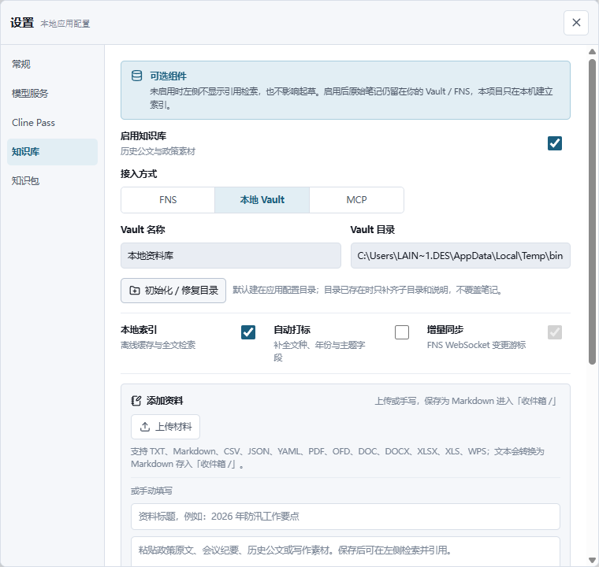

# 建立和连接知识库

[返回文档入口](index.md)

## 建立本地 Vault

知识库是可选组件。没有 Obsidian 或 FNS 时，可以直接在 设置 → 知识库 → 本地 Vault 里点「创建本地知识库」：应用会在配置目录下建立 `knowledge-base/`，并准备好 `收件箱/`、`政策/`、`公文/` 三个目录和一份说明文件。已有目录不会被覆盖。

建好后有三种使用方式：

- 直接上传材料：在「添加资料」里选择文件（TXT、Markdown、CSV、JSON、YAML、PDF、OFD、DOC、DOCX、XLSX、XLS、WPS），桌面内核把可读文字转成 Markdown 存入 `收件箱/`；可以一次选多份，逐份显示解析进度，失败的文件会单独列出；
- 在应用内手动新建：填写标题和正文，保存为 Markdown，勾选「保存后重建索引」即可立刻在写作台点「知识库」检索、引用；
- 用自己的文件：把 Markdown 放进 `政策/` 或 `公文/`，或在 Obsidian 里继续编辑同一目录，回到设置点「重建索引」。

索引保存在本机 SQLite，原始笔记保留在自己的目录。索引在本机，不等于推理也在本机：被选作引用的内容可随模型请求发送到所配置的服务。FNS 与 MCP 仍保留给已经有远程库的用户：FNS 走 REST + WebSocket 增量同步，MCP 走 Bearer token；两者都只在明确配置后访问对应地址。

本地检索按标题和正文匹配，`收件箱/` 里的新资料、`政策/` 里的依据和 `公文/` 里的历史件都会出现在知识库弹窗。「更多 → 归档到知识库」可把当前公文写回知识库，作为下一次写作的参考件。

知识库路径、认证和密级要与当前任务匹配。对 FNS/MCP 的访问只在配置后发生，接入前确认对应服务器和凭据的授权范围。
