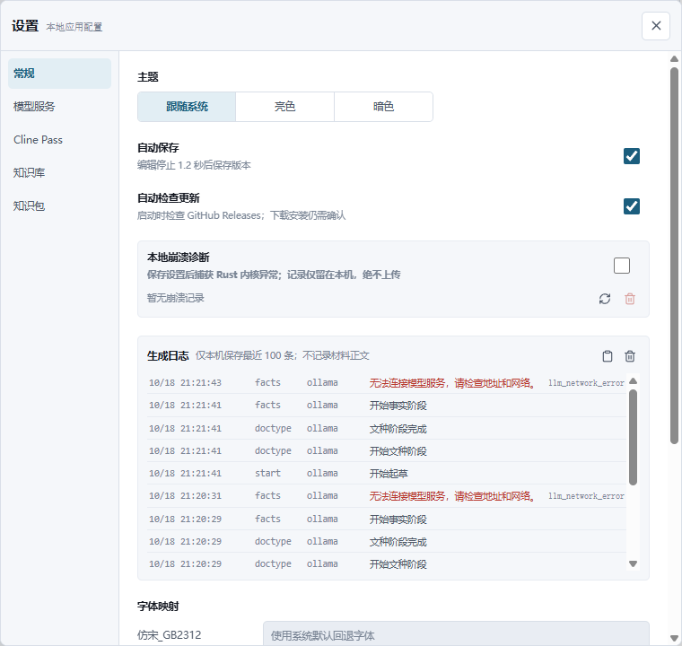

# 排查生成失败并更新应用

[返回文档入口](index.md)

## 检查生成日志

写作台点「开始写作」后，材料会直接进入完整流水线；输入框下方显示阶段进度（文种 → 事实 → 检索 → 骨架 → 起草 → 降 AI 味 → 校验 → 校对 → 回查 → 评分），生成完成自动切到版式预览，可继续在「编辑」里修改。失败时错误显示在输入框下方，当前模型与阶段名一并给出，可更换模型后重试。

每次起草都会写入本机的生成日志（设置 → 常规，最近 100 条）：开始/完成、阶段、模型服务、错误码，不记录材料正文。常见错误码：

- `llm_network_error`：模型地址不可达。用 Ollama 时先确认 `ollama serve` 已启动；云端服务检查地址、Key 与网络。
- `provider_auth_error`：Key 无效或无权限。
- `update_*` 只属于在线更新，不会出现在起草日志。

日志可一键复制，便于排查或反馈。

## 检查和安装更新

应用启动后会读取 GitHub Releases 的 `latest.json`（`https://github.com/hellomrli/my-bingbi/releases/latest/download/latest.json`），有更新时在右上角提示，点「立即更新」才会下载安装。设置 → 常规 → 关于与更新 也可手动检查，并显示当前版本与发现的新版本。

- Windows 更新包为 NSIS 安装器，Linux 为 AppImage；两者都由发布流水线生成 `.sig` 并写入 `latest.json`。
- 更新公钥已固化在 `src-tauri/tauri.conf.json`，本地构建也能检查同一条签名通道；私钥只存在仓库 secret `TAURI_SIGNING_PRIVATE_KEY`。
- 校验失败、网络失败、清单缺少当前平台等错误会给出不同提示，不会把签名失败误报成"已是最新"。
- 只有发布比当前更高的版本才会提示更新。

发布新版本：同步提升 `package.json`、`src-tauri/tauri.conf.json` 和 `src-tauri/Cargo.toml` 的版本号，打 `vX.Y.Z` tag；release workflow 会构建、签名并上传安装器与 `latest.json`。公钥轮换时必须同时更新 `tauri.conf.json` 中的 `plugins.updater.pubkey` 和 `TAURI_SIGNING_PRIVATE_KEY` secret，否则旧版本无法验证新包。

关闭、重载或更新前等待保存完成。保存失败时保留当前文档并重试，备份数据目录时同时保留 SQLite 所需文件；凭据使用系统 Keyring，不在数据库备份中携带。数据路径见 [存储规范](STORE-SPEC.md)。
