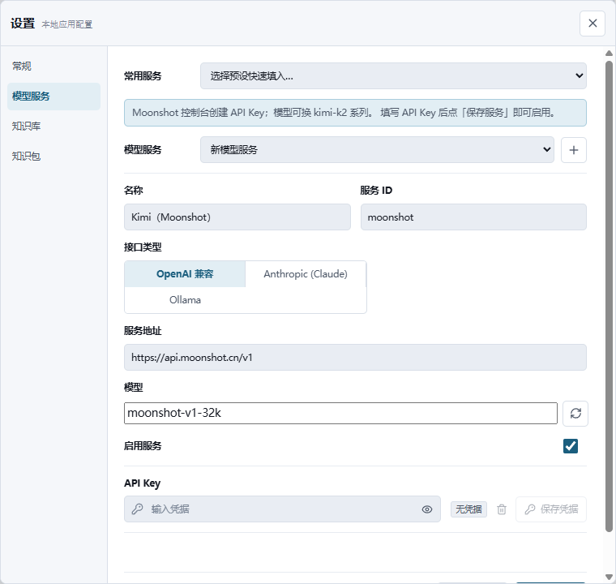
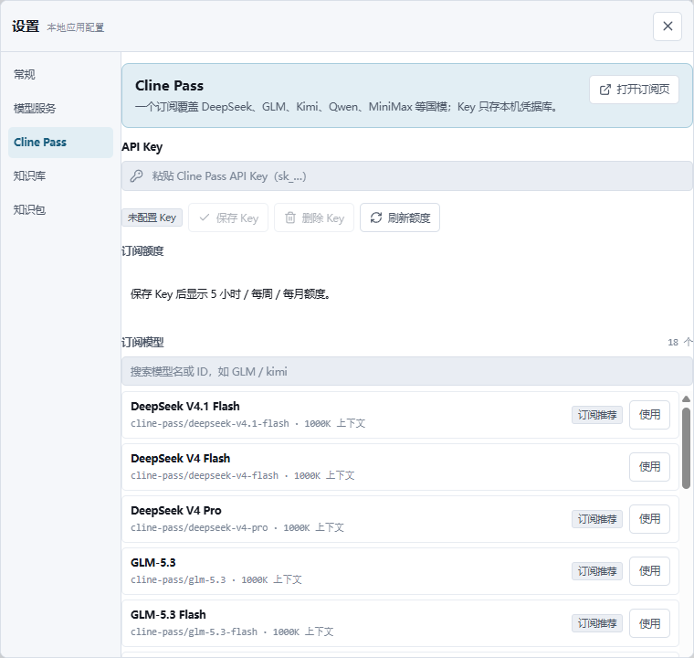

# 配置模型服务与 Cline Pass

[返回文档入口](index.md)

## 选择模型服务

设置 → 模型服务 →「常用服务」里选一个预设，表单会自动填好地址与默认模型；粘贴 API Key 后一次保存即可启用。预设只是模板，不会预先写入配置。

| 预设 | 默认地址 | 默认模型 |
| --- | --- | --- |
| 通义千问（DashScope） | `https://dashscope.aliyuncs.com/compatible-mode/v1` | `qwen-plus` |
| Kimi（Moonshot） | `https://api.moonshot.cn/v1` | `moonshot-v1-32k` |
| 智谱 GLM | `https://open.bigmodel.cn/api/paas/v4` | `glm-4-plus` |
| 腾讯混元 | `https://api.hunyuan.cloud.tencent.com/v1` | `hunyuan-turbos-latest` |
| 百度千帆（文心） | `https://qianfan.baidubce.com/v2` | `ernie-4.5-turbo-128k` |
| 硅基流动 | `https://api.siliconflow.cn/v1` | `deepseek-ai/DeepSeek-V3` |
| 讯飞星火 | `https://spark-api-open.xf-yun.com/v1` | `generalv3.5` |
| Google Gemini | `https://generativelanguage.googleapis.com/v1beta/openai` | `gemini-2.5-flash` |
| OpenRouter | `https://openrouter.ai/api/v1` | `openai/gpt-4o-mini` |
| Groq | `https://api.groq.com/openai/v1` | `llama-3.3-70b-versatile` |
| xAI Grok | `https://api.x.ai/v1` | `grok-3-mini` |
| Mistral | `https://api.mistral.ai/v1` | `mistral-small-latest` |
| LM Studio（本地） | `http://127.0.0.1:1234/v1` | `local-model` |
| vLLM / 自建（本地） | `http://127.0.0.1:8000/v1` | 部署时指定的模型名 |

模型名会随厂商更新，可在表单里直接改，或点「嗅探上游可用模型」。豆包（火山方舟）需要 `ep-` 接入点 ID，Azure OpenAI 使用 `api-key` 头而非 Bearer，两者暂未做预设，可用「新增模型服务」自行填写。

### Cline Pass 订阅

Cline Pass 是一个聚合订阅网关，一个 Key 可以使用 DeepSeek、GLM、Kimi、Qwen、MiniMax、MiMo 等一批国模。设置 → Cline Pass：

- 保存 API Key（写入系统 Keyring，界面只显示是否已保存）；
- 刷新并查看 5 小时 / 每周 / 每月额度与重置时间；
- 从订阅模型列表里搜索、切换当前模型，切换后自动启用 `cline-pass` 服务；
- 「打开订阅页」在系统浏览器打开 [cline.bot/cline-pass](https://cline.bot/cline-pass) 办理或管理订阅，应用内不承载支付页面。

网关地址为 `https://api.cline.bot/api/v1`，模型 ID 形如 `cline-pass/glm-5.3`。模型目录优先读取官方订阅列表与网关 `/models`，离线或接口不可用时回退到内置目录；额度读取的是 `/users/me/plan/usage-limits`。Key 与额度请求都只发生在 Rust 内核，WebView 不直接访问 Cline Pass。

预设和内置离线目录不是服务可用性或额度承诺。确认实际模型、地址和权限后再运行；Key 只保存在系统凭据库。不同流水线阶段可分配不同模型，修改后的能力和密级约束仍由内核检查。
