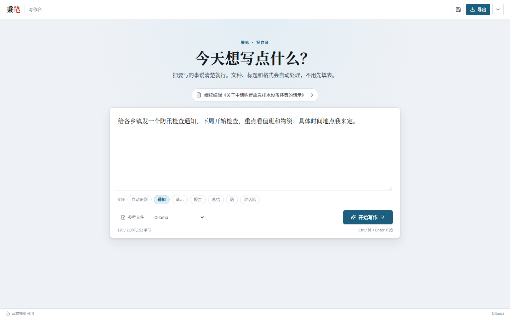
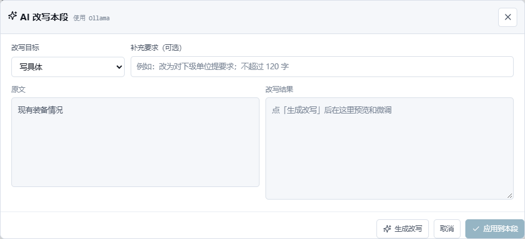
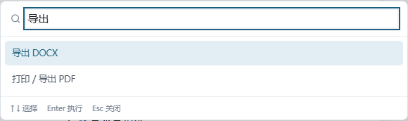

# 起草、改写与使用模板

[返回文档入口](index.md)

先安装桌面应用并配置模型，随后在写作台输入自己的任务材料。起草和 AI 改写可能调用计费接口。

## 输入材料

写作台只保留一个输入框和一行可选控件：

- 文种：默认「自动识别」；想固定文种时点「通知 / 请示 / 报告 / 总结 / 函 / 讲话稿」之一，避免模型路由摇摆。
- 参考文件 / 知识库：都可跳过。参考文件区支持拖拽或点击添加 TXT、Markdown、CSV、JSON、YAML、PDF、OFD、DOC、DOCX、XLSX、XLS、WPS；添加后写作台只显示文件名和份数，不把全文粘贴进输入框，起草时才读取内容。知识库启用后可从历史公文里搜索引用，同样只显示资料名。
- 模型：默认使用当前模型服务；没有配置时输入框下方会出现「配置模型」入口，不会阻塞先写材料。
- 文档信息：发文字号、主送机关、落款、日期、密级都收在「更多 → 文档信息」里，全部可选，不填也能生成和导出。

生成后进入全宽文档页：「编辑」按段落修改，「版式」查看 GB/T 9704 版心预览；质检和事实台账收进右侧抽屉，不再常驻占用屏幕。

## 模板库与写作方法

模板分两层：每个文种有一份默认骨架（`templates/{doc_type}.yaml`），另有按场景细分的变体（如“会议通知”“工作部署通知”“经费请示”“整改报告”）。模板覆盖多个文种与场景；数量以启用的知识包为准：

| 文种 | 场景模板 |
| --- | --- |
| 通知 | 会议、工作部署、转发、任免、节假日安排 |
| 报告 | 情况、年度、整改 |
| 请示 | 申请经费、事项批准 |
| 函 | 商洽、复函、感谢 |
| 纪要 | 办公会、专题会 |
| 总结 | 年度、专项 |
| 讲话稿 | 动员、总结 |
| 方案 | 专项工作、实施方案 |
| 工作汇报 / 简报 / 议案 / 命令 / 公告 / 通告 / 批复 / 邀请函 / 证明 / 备忘录 / 发言稿 / 表彰决定 | 各有场景骨架 |

模板按文种在起草时自动加载；请求携带 `templateId`，内核只加载该模板的标题层级、固定称谓与结语。起草输出会按“一、/（一）/1.”解析回真实的 ODoc 标题与段落，不再把整篇正文塞进第一个段落。

写作方法来自多个开源 Skill 项目的提炼改写，已转成知识包参考材料并绑定到对应阶段：`document-type-router.md`（文种判断）、`structure.md` / `language.md`（结构、数字日期与标点）、`drafting-patterns.md` / `sentence-bank.md`（章法与句式）、`quantitative-style.md`（句长、顿号、标题与力度词节奏）、`fact-extraction.md` / `citation-policy.md`（事实台账与引用核验）、`humanizer.md`（降 AI 味）、`scoring-rubric.md`（评分量表）。内容为本地重写，不是原文照搬；来源与许可见各包 `THIRD_PARTY.md`。

## 改一段，不动全文

正文编辑里每个文字块都有「AI 改写」按钮。选一个目标（写具体 / 压缩 / 更规范 / 去 AI 味 / 只校对）和可选的补充要求，模型只改写这一段；结果先进入预览，确认后才写回文档。

改写提示带三条硬约束：不新增或修改数字、日期、文号、金额、单位、人名和机构名；不改变原意与段落功能；只输出正文。应用前还会对比原文与结果的数字、日期、文号：有新增或缺失时列出差异，必须勾选「我已核对上述变化」才能应用。改写使用当前选中的模型服务，涉密文档仍受「仅本地模型」限制。

## 命令面板与文档搜索

`Ctrl/⌘+K` 打开命令面板，统一执行写作台、新建、最近文档、保存、导出、打印、审核、Cline Pass、设置、切换主题和切换视图；支持方向键与 Enter。最近文档对话框可按标题或文种即时过滤，文档多时不用翻列表。

保存后的最近文档支持搜索、版本 diff 和恢复。质检、事实与导出步骤见 [交付指南](exporting.md)。
